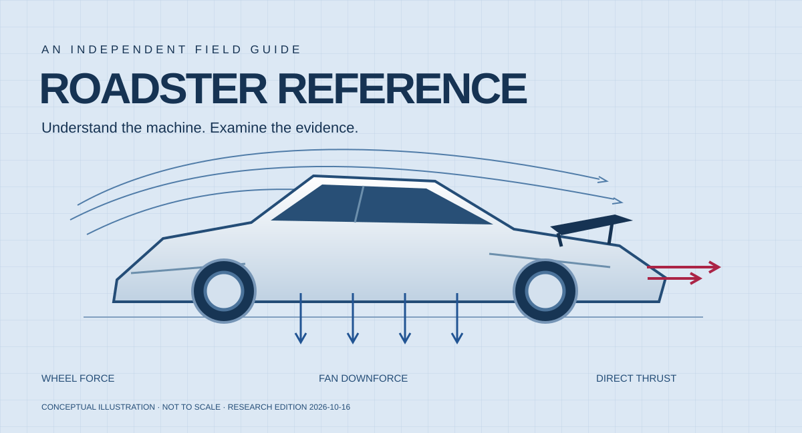

<p align="center"></p>

# Roadster Reference

**An independent, open-source field guide to the new Tesla Roadster.**

Understand the engineering. Trace the announcements. Check the evidence before sharing the headline.

[Start learning](docs/start-here.md) · [What changed in 2026](docs/2026-reveal.md) · [Claims & evidence](docs/claims.md) · [News timeline](docs/timeline.md) · [Source library](docs/sources.md) · [Audit findings](research/audit.md) · [Run the explorer](#explore-locally)

**Research cutoff: October 16, 2026.** A curated first edition, not a live feed or an exhaustive archive. Tesla has demonstrated a redesigned prototype; the reported production target is **2028**, not a verified delivery date. [Reuters](https://live.euronext.com/en/financial-news/teslas-new-roadster-turns-air-spacex-thrusters-wont-land-until-2028)

> **Read this first:** the 2017 red concept and the October 2026 redesign are different evidence sets. Do not combine the old 620-mile / four-seat claims with the new car’s specifications. [Original Tesla reveal, 31:10](https://www.youtube.com/watch?v=5RRmepp7i5g&t=1870s) · [Current Tesla page](https://www.tesla.com/roadster)

The audit reviewed every source, structured claim and timeline event. **42 source records support their stated scope, 3 have limited verification, 1 obsolete citation is retired, and 1 remains unverified.** Complete reservation-agreement terms are not established. See the [audit](research/audit.md) and [record-by-record review](docs/audit-ledger.md).

## Choose your route

| You want to… | Go here |
|---|---|
| Understand the car in ten minutes | [Beginner’s guide](docs/start-here.md) |
| Compare Performance, Thrust and Rocket | [2026 reveal and configuration guide](docs/2026-reveal.md) |
| Learn how fans, wings and thrusters work | [Engineering explained](docs/engineering.md) |
| Make sense of spectacular acceleration numbers | [Measurement guide](docs/testing.md) |
| Reproduce the math | [Physics lab](docs/physics-lab.md) |
| Trace deadlines and recent news | [Dated timeline](docs/timeline.md) |
| Find original material and assess its limits | [Annotated source library](docs/sources.md) |
| Identify what still needs evidence | [Open questions](docs/open-questions.md) |
| Understand road-use and reservation context | [Availability and regulation](docs/availability.md) |
| Contribute a correction | [Contribution guide](CONTRIBUTING.md) |

## What makes this useful

- Every structured claim has source IDs, a vehicle era, a status, a checked date and an unresolved question.
- Manufacturer claims, reported observations, historical targets and unknowns stay distinct.
- A searchable, responsive browser explorer works locally without a backend or third-party libraries.
- Reproducible calculators explain acceleration, drag, suction force and energy using explicit inputs.
- The research log records inaccessible material and review limits.
- Audit receipts are bound to the exact records, so an edited claim cannot silently retain an old review.

The aspiration is to become a dependable reference. Popularity, completeness and technical superiority are not established by publishing a repository.

## Explore locally

Requires Python 3.11+; no packages, API keys or account required.

```sh
python3 tools/validate.py
python3 -m unittest discover -s tests -v
python3 tools/build.py
python3 -m http.server 8765 --directory site/dist --bind 127.0.0.1
```

Open [the local explorer](http://127.0.0.1:8765). It includes claim/source search, era and evidence filters, the timeline, learning chapters and an acceleration calculator. The generated HTML also opens directly from disk. GitHub itself renders the complete Markdown guide.

```sh
python3 tools/physics.py acceleration --time 0.85 --mass 1800 --speed-mph 60
python3 tools/physics.py drag --speed-mph 230 --cda 0.60
python3 tools/physics.py suction --pressure-pa 5000 --area-m2 3
python3 tools/physics.py range --usable-kwh 100 --wh-per-km 200
```

These are educational scenarios, **not measured Roadster specifications or vehicle-control software**. The example mass, drag area, pressure, area and battery capacity are hypothetical.

## Repository map

```text
data/       Source registry, claim ledger, timeline and edition metadata
docs/       Learning chapters and generated reference tables
research/   Method, access notes, interview locators and coverage gaps
tools/      Standard-library build, validation and physics code
site/       Accessible, static reading interface
tests/      Numerical and evidence-integrity checks
assets/     Original repository artwork
```

## Independence and reuse

This is a community educational project, unaffiliated with Tesla or SpaceX. It contains original explanations and software, links to public material, and attributed factual summaries. It contains no Tesla firmware, leaked files, service credentials or proprietary vehicle code. External articles, videos, trademarks and patent rights remain with their owners.

Original code and project-authored content are available under the [MIT License](LICENSE), subject to [third-party rights](THIRD_PARTY_NOTICES.md). See [how to cite this project](CITATION.cff), [editorial method](research/methodology.md) and [contributing](CONTRIBUTING.md).
