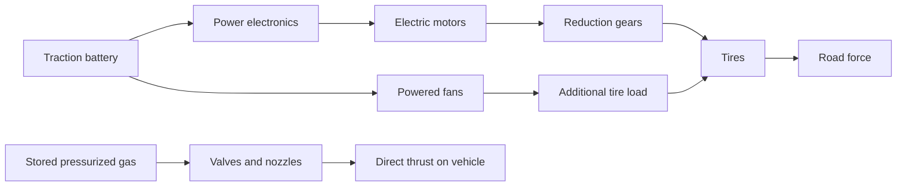

# How the systems work

[Beginner’s guide](start-here.md) · [Compare versions](2026-reveal.md) · [Measurement guide](testing.md)

Learn what the battery, motors, tires, wings, fans and thrusters each contribute. Read the explanations in order; the maths and final flow diagram are optional. **Every numerical example is hypothetical, not a measured Roadster specification.** The [claims and sources](claims.md) identify which vehicle-specific details have evidence.

## 1. The battery supplies energy; motors turn the wheels

- The **traction battery** is the main battery used to move the car. It stores energy.
- **Power electronics** control the electricity supplied to the motors.
- Motors produce **torque**, a turning effect, like twisting a wrench. **Reduction gears** let a fast-spinning motor turn the wheels more slowly with greater torque, allowing for losses. Think of a bicycle’s lower gears: less speed for more turning effort.
- **Regenerative braking** uses the motor as a **generator**, converting some of the car’s motion energy back into electricity as it slows. Some of that energy returns to the battery. Cooling helps keep the battery, motors and electronics within their temperature limits.

See [DOE’s electric-car component guide](https://afdc.energy.gov/vehicles/how-do-all-electric-cars-work). Motor torque and wheel torque are different measurements because gears and losses affect the result; do not compare them directly.

The [Moravy interview, 2:41–3:13](https://www.youtube.com/watch?v=22rvpUecLts&t=161s) describes two independently controlled rear motors. Different turning forces at the left and right wheels can help the car turn, but cannot remove the tires’ grip limit.

### Example: energy is an amount; power is a rate

**kWh** (kilowatt-hours) measures stored or used energy. **kW** (kilowatts) measures how quickly energy is transferred. Think of water in a tank versus its flow rate. One **MW** (megawatt) is 1,000 kW.

In an ideal example:

1. Start with **100 kWh** of available energy.
2. Use it continuously at **1,000 kW**.
3. Divide amount by rate: 100 ÷ 1,000 = **0.1 hours**, or **6 minutes**.

This ignores losses and battery operating limits. It does not establish Roadster battery size, sustained output or driving range.

## 2. Tires need grip to turn that effort into motion

The tires push against the road. If the demanded push exceeds their grip, they slip. **Downforce** is an air-generated push toward the road that can help the tires grip; it does not add mass to the car.

**Optional maths:** these equations describe a simplified grip and acceleration model.

**μ** (pronounced “mu”) is a number representing how well the tire and surface grip. **Normal load** is the force pressing the tire into the road. **Net force** is the combined push after opposing forces are accounted for. Force is measured in **newtons (N)**; mass in **kilograms (kg)**. Acceleration in **m/s²** describes the speed change in metres per second, each second.

```text
maximum forward tire force ≈ μ × normal load
vehicle acceleration = net force / mass
```

The formula is only an approximation. Real grip changes with tire temperature and load, and must be shared between turning and accelerating. Acceleration also shifts the load carried by the front and rear tires. Our lab does not model those details; more motor power does not guarantee a matching increase in acceleration.

## 3. Wings use moving air; drag resists motion

An **active wing** changes position to alter the balance between downforce and **drag**, the resistance caused by moving through air. Its force depends on airflow: a wing alone cannot hold a stationary car upside down in still air. Tesla describes wings and fan suction separately on its [product page](https://www.tesla.com/roadster).

**Air density** means how much air mass occupies a given space. A **drag coefficient** is a number summarizing how the shape interacts with airflow. **Reference area** is the chosen area used with that number to represent size; it must match the area used to determine the coefficient.

**Example: double the speed in a model where air density, drag coefficient and reference area stay fixed.**

1. Drag scales with speed squared: 2 × 2 = **4 times the drag**.
2. Overcoming that drag also requires moving twice as fast: 4 × 2 = **8 times the power to overcome air resistance**.

This concerns power used to overcome air resistance, not every source of energy use. It helps explain why top speed requires more than a strong launch. [NASA’s drag equation](https://www1.grc.nasa.gov/beginners-guide-to-aeronautics/drag-equation/)

**Optional maths:** **q**, or dynamic pressure, combines air density and speed to describe the strength of airflow effects. Use speed in metres per second and area in square metres.

```text
q = ½ × air density × speed²
drag = q × drag coefficient × reference area
drag power = drag × speed
```

## 4. Fans can help with grip even at low speed

Fans remove air from a partly sealed space beneath the car. Pressure there drops, and higher surrounding air pressure presses the car toward the surface. Unlike a wing, the fan system does not rely on the car moving quickly to generate that pressure difference.

**Example: pressure acts over an area.** A **pascal (Pa)** is one newton of force per square metre. A **square metre (m²)** is an area one metre by one metre.

1. Suppose the pressure difference is **5,000 Pa**: 5,000 N of force per square metre.
2. Suppose it acts evenly across **3 m²**.
3. Multiply: 5,000 × 3 = **15,000 N**, or **15 kN**. A kilonewton (kN) is 1,000 N.

That is an ideal, evenly distributed pressure calculation. Leaking seals, bumps, wheel openings and the distance between the car’s underside and the road change the result. Maintaining the pressure difference needs airflow and power; pressure difference multiplied by air volume moved per second gives ideal airflow power before losses.

McMurtry documented its own stationary upside-down demonstration in April 2025. That illustrates the mechanism; it does not establish equal capability for the Roadster. [McMurtry’s account](https://mcmurtry.com/upside-down-driving/)

An upside-down car still has to support its weight, with a margin beyond the minimum required force. When a source describes downforce in kilograms, it means a force equivalent to that mass’s weight, not extra vehicle mass. These examples cannot establish that a design is safe for upside-down operation.

## 5. Thrusters push by releasing gas

A **cold-gas thruster** releases stored gas through a shaped outlet called a **nozzle**, without burning fuel. The gas moves one way and pushes the vehicle the other, like a released balloon. The expelled material is called **propellant**; **valves** control its flow. “Cold” distinguishes this from burning fuel, not a promise that every component stays at room temperature. [NASA’s cold-gas overview](https://www.nasa.gov/smallsat-institute/sst-soa/in-space_propulsion/)

**Example: how much gas, and how fast?** Suppose gas leaves the nozzle at the same pressure as the surrounding air. This is what **pressure-matched** means here.

1. Release **40 kg of gas each second**: a mass flow rate of 40 kg/s.
2. Let it leave at **500 metres per second** relative to the nozzle.
3. Multiply: 40 × 500 = **20,000 N**, or **20 kN of thrust**.

These invented inputs would consume 40 kg of gas every second at that rate. They do not establish Roadster thrust or operating time. Gas flow and force can change as the supply empties.

**Optional maths:** the general equation also includes a pressure contribution. **F** means thrust force, **exhaust velocity** is the speed of the expelled gas relative to the nozzle, and **ambient pressure** is the surrounding air pressure.

```text
F = mass flow rate × exhaust velocity + nozzle exit area × (exit pressure − ambient pressure)
```

In the example, the pressure difference is zero, so that extra term contributes nothing. Real nozzle design and operating conditions matter. [NASA’s thrust equation](https://www1.grc.nasa.gov/beginners-guide-to-aeronautics/rocket-thrust-equation/)

A push through the car’s balance point, its **center of mass**, changes its motion without directly adding a turning effect. An off-center push can also turn it. Engineers call movement **translation**, turning **rotation**, and a turning effect a **moment**.

**Six degrees of freedom** means three ways to move—forward/back, left/right, up/down—and three ways to rotate: nose up/down, nose left/right and side-to-side tilt. Controlling a short maneuver does not establish operating duration or what happens if a component fails.

## 6. Cooling and charging performance depend on time

**Thermal** means related to heat. Battery **cells** are the individual energy-storing units in a battery pack. Cells, motors and electronics generate heat that cooling systems must carry away. A short power burst does not prove the car can repeat that performance lap after lap; repeated measured runs would provide better evidence.

For charging, **peak power** is the highest charging rate, while **average power** covers the full charging interval. A **charge curve** shows how that rate changes as the battery fills. A **battery window**, such as 15–80%, specifies the starting and ending charge levels.

**Ideal example: add 30 kWh at an average 150 kW, ignoring losses.**

1. Divide the energy added by average power: 30 ÷ 150 = **0.2 hours**.
2. Convert hours to minutes: 0.2 × 60 = **12 minutes**.

Knowing only a peak of 150 kW would not justify that answer. **Taper** means the rate decreases during charging; **conditioning** means bringing the battery to a suitable temperature. Temperature limits, losses and charger capability affect actual charging time.

The Roadster interviews give differing charge-time summaries and one ambiguous caption. See **C17** in the [claims and sources](claims.md). Those reports do not establish a final charge curve or battery size.

## 7. A patent describes an invention; it does not test a car

A patent **grant** is an issued patent; a published **application** is a request for a patent, not itself a grant. Patent **claims** are numbered statements describing the invention in legal terms, not measured performance claims.

- The [adaptive-downforce grant](https://image-ppubs.uspto.gov/dirsearch-public/print/downloadPdf/12377920) describes fan airflow and selectable **skirts**: parts along the underside that help control air leakage.
- The [electric fan-car grant](https://image-ppubs.uspto.gov/dirsearch-public/print/downloadPdf/12746987) describes **ducts**, or air passages, and **strakes**, guiding vanes at the outlet. It is a different arrangement.
- The [rear-wing application](https://image-ppubs.uspto.gov/dirsearch-public/print/downloadPdf/20260285418) describes wings that extend, rotate and retract in response to an impact.

The wing description’s paragraph 0046 gives up to **700 kg** of downforce in an example. **Dependent claim 10**, which adds requirements to an earlier claim, gives **400–500 kg**. These are different passages, not competing measured Roadster results. The kilogram figures use the force shorthand explained above.

The [document review](../research/document-review.md) records the original claim-set reviews and exact locations. The documents do not establish which parts a delivered Roadster will contain, its measured performance or its approval for use. Patent legal-history and legal-scope analysis remain outside this review.

The project’s original software is open source. That does not grant rights to Tesla technology; Tesla’s [patent-pledge terms](https://www.tesla.com/en_ph/legal/additional-resources) are a separate matter.

## Optional reference: follow the energy and force paths

The arrows below summarize the systems just explained. This conceptual diagram is not a Tesla wiring or plumbing diagram.



**Continue learning:** [Judge performance measurements](testing.md), [try the physics lab](physics-lab.md), or [choose another topic](start-here.md#where-to-go-next).
