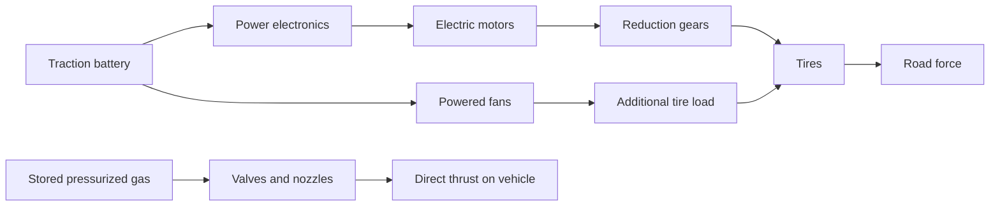

# How the systems work

[Home](../README.md) · [Physics lab](physics-lab.md) · [Interview notes](../research/interview-notes.md)

This chapter explains general mechanisms. Equations and illustrative examples do not reverse-engineer Tesla’s implementation. The [claim ledger](claims.md) records which vehicle-specific details have supporting material.

## 1. Electrical energy becomes wheel force

A traction battery stores energy. Power electronics regulate electrical supply to motors; gearing trades rotational speed for torque at the wheels. Cooling keeps the battery, electronics and motors within their operating temperature ranges. Regenerative braking can return some motion energy to the battery. [DOE component guide](https://afdc.energy.gov/vehicles/how-do-all-electric-cars-work)



Conceptual energy and force paths; not a Tesla wiring or plumbing diagram.

With two independently controlled rear motors, a controller can request different left/right torques. That can help control turning behavior, but it does not remove the tire’s grip limit. The rear-drive description comes from the [Moravy interview, 2:41–3:13](https://www.youtube.com/watch?v=22rvpUecLts&t=161s).

### Why a megawatt is not a range figure

Power measures energy per unit time. At a hypothetical continuous draw of 1,000 kW, 100 kWh would be consumed in 0.1 hours, or six minutes, before losses or usable-energy constraints. This is dimensional arithmetic, not a claim that a Roadster has a 100-kWh battery or can sustain that output.

Likewise, a motor’s torque is not automatically wheel torque. Gear reduction, efficiency and the number of motors matter. A historic torque number without its measurement location cannot be compared directly with a new motor-output number.

## 2. Tires turn force into acceleration

For a deliberately simplified friction model:

```text
maximum longitudinal tire force ≈ μ × normal load
vehicle acceleration = net force / mass
```

Here μ is an effective tire/surface coefficient, not a fixed universal constant. Real tires are load-sensitive, temperature-dependent and share available grip between steering and acceleration. Rear-drive cars also depend on axle loads and weight transfer. Our lab does not model those effects.

This explains why adding motor power eventually produces wheelspin rather than an equal increase in acceleration. Extra downforce can increase normal load; direct thruster force offers a different force path.

## 3. Wings need relative airflow

Aerodynamic forces commonly scale with dynamic pressure:

```text
q = ½ × air density × speed²
drag = q × drag coefficient × reference area
drag power = drag × speed
```

At constant air density and drag area, doubling speed multiplies drag by four and aerodynamic power demand by eight. This is why extreme top speed involves much more than an impressive low-speed launch. [NASA drag equation](https://www1.grc.nasa.gov/beginners-guide-to-aeronautics/drag-equation/)

An active wing changes position to alter the tradeoff between downforce and drag. Its useful force depends on the airflow; a wing alone cannot support an inverted stationary car in still air. Tesla describes active aero and fan suction separately on its [current product page](https://www.tesla.com/roadster).

## 4. Fans can create grip at low vehicle speed

A fan removes air from a partly sealed underbody region. Surrounding pressure then pushes the vehicle toward the running surface:

```text
suction force ≈ pressure difference × effective sealed area
```

For example, 5,000 Pa acting over 3 m² produces 15,000 N in the ideal uniform-pressure model. Those inputs are illustrative. Seal leakage, ride height, bumps, wheel openings and flow resistance change the actual force. Maintaining pressure requires airflow and power; pressure difference times volumetric flow gives ideal fluid power before losses.

There is a useful prior example: McMurtry documented its own stationary inversion demonstration in April 2025. That establishes an example of the mechanism, not equivalence between the cars. [McMurtry’s account](https://mcmurtry.com/upside-down-driving/)

An upside-down vehicle needs enough adhesion to support its weight plus appropriate operating margin. Saying “downforce” in kilograms really means a force equivalent to a mass’s weight; the force unit is newtons. Inversion does not cancel gravity.

## 5. Cold gas adds a separate source of force

A cold-gas system releases stored pressurized propellant through a nozzle without combustion. The gas moves one way and pushes the vehicle the other. “Cold” distinguishes this from combustion propulsion; it does not mean every component stays at room temperature. [NASA cold-gas overview](https://www.nasa.gov/smallsat-institute/sst-soa/in-space_propulsion/)

The general nozzle equation is:

```text
F = mass flow rate × exhaust velocity + nozzle exit area × (exit pressure − ambient pressure)
```

For a pressure-matched simplified example, 40 kg/s expelled at 500 m/s gives 20,000 N of thrust. These are hypothetical inputs. Ambient pressure and nozzle design matter; force and gas consumption are time-dependent as a stored-gas system depletes. [NASA thrust equation](https://www1.grc.nasa.gov/beginners-guide-to-aeronautics/rocket-thrust-equation/)

Different nozzle locations can create both translation and rotation. A force through the center of mass primarily translates the vehicle; an offset force also creates a moment. Six-degree-of-freedom control must manage three translational and three rotational axes. A short controlled maneuver does not establish endurance, practical range or fault tolerance.

## 6. Thermal and charging performance need duration

A short power burst and sustained track use are different thermal tasks. Heat must move from cells, motors and electronics through cooling systems into the environment. A cooling design described in an interview is evidence of the claimed approach; repeated instrumented laps are evidence of sustained capability.

Charging has the same distinction. Peak power is a point on a curve. Total time depends on average power over the chosen battery window:

```text
ideal charging time in hours = energy added in kWh / average input power in kW
```

Taper, thermal limits, conditioning, losses and charger capability change the real result. The primary interviews also use differing summaries and one ambiguous charge-window caption. See C17 in the [claim ledger](claims.md); a caption must not be silently corrected into a final specification. Do not reverse-calculate a final battery size from a provisional peak-power headline.

## 7. A patent teaches a concept, not a delivered car

[US12377920B1](https://patents.google.com/patent/US12377920B1/en) describes adaptive downforce arrangements assigned to Tesla. It is useful technical reading. It does not establish that a particular embodiment ships on Roadster, reaches a claimed force, or satisfies road requirements. The [official electric fan-car gazette entry](https://patentsgazette.uspto.gov/week39/OG/html/1550-5/US12746987-20260929.html) and the [official rear-wing application](https://image-ppubs.uspto.gov/dirsearch-public/print/downloadPdf/20260285418) were also located during the audit. The first claim of the fan grant and the cover/abstract of the wing application were reviewed; their entire legal scope was not.

The project’s original software is open source. That does not grant rights to Tesla technology; Tesla’s [patent-pledge terms](https://www.tesla.com/en_ph/legal/additional-resources) are a separate matter.
